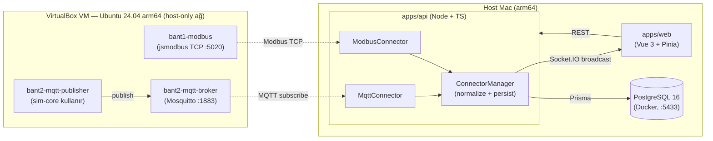
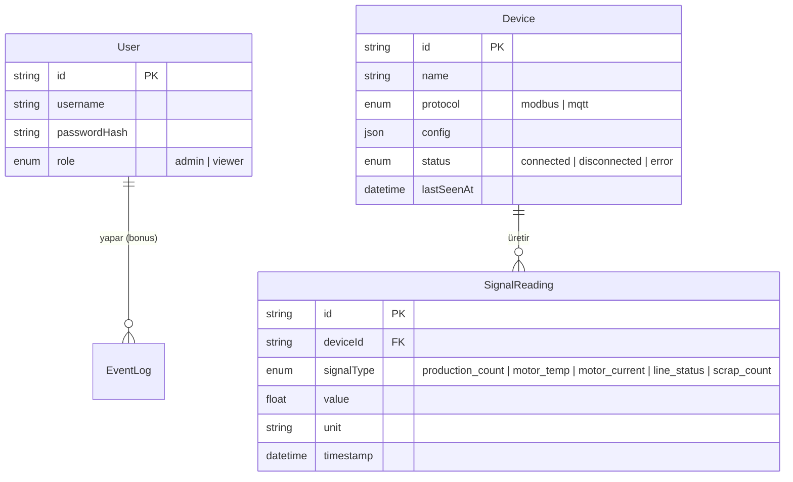

# FactorEdge — Mini Akıllı Fabrika

İki üretim bandını (Bant 1: Modbus TCP, Bant 2: MQTT) tek bir web platformundan canlı izleyen, geçmiş verisini grafikle gösteren ve rol bazlı erişim kontrolü olan bir izleme/yönetim sistemi.

## İçindekiler

1. [Mimari](#mimari)
2. [Kurulum ve Çalıştırma](#kurulum-ve-çalıştırma)
3. [Veri Modeli](#veri-modeli)
4. [Protokol Şemaları](#protokol-şemaları)
5. [Önemli Kararlar](#önemli-kararlar-ve-nedenleri)
6. [Bilerek Yapılmayanlar](#bilerek-yapılmayanlar)
7. [AI Aracının Yanlış/Eksik Önerdiği Noktalar](#ai-aracının-yanlışeksik-önerdiği-noktalar)
8. [Dayanıklılık Testi](#dayanıklılık-testi)
9. [Varsayılan Kullanıcılar](#varsayılan-kullanıcılar)

---

## Mimari



`packages/sim-core`, her iki bandın üretim/sıcaklık/akım/fire davranışını yöneten **ortak, saf TypeScript state machine'idir** (STOPPED→RUNNING→FAULT). Hem `vm/bant1-modbus` hem `vm/bant2-mqtt-publisher` aynı mantığı kullanır, sadece transport (Modbus register'lar vs. MQTT JSON) farklıdır.

Backend'de her protokol kendi `DataSourceConnector` implementasyonuna sahiptir (`ModbusConnector`, `MqttConnector`), ancak ikisi de aynı `NormalizedReading { deviceId, signalType, value, unit, timestamp }` modeline dönüştürülür — dashboard/history kodu verinin hangi protokolden geldiğini hiç bilmez.

---

## Kurulum ve Çalıştırma

### Gereksinimler
- Node.js 20+, npm 10+
- Docker Desktop (host'ta Postgres için)
- VirtualBox 7.x (simülatörlerin çalıştığı VM için)

### 1. Bağımlılıklar
```bash
npm install   # repo kökünde, tüm workspace'leri kurar
```

### 2. Host'ta PostgreSQL
```bash
docker run -d --name factoredge-db \
  -e POSTGRES_USER=factoredge -e POSTGRES_PASSWORD=changeme -e POSTGRES_DB=factoredge \
  -p 5433:5432 -v factoredge-db-data:/var/lib/postgresql/data postgres:16
```
> Port **5433** kullanılır (5432 değil) — host'ta native kurulu başka bir PostgreSQL ile çakışmayı önlemek için. Kendi ortamınızda 5432 boşsa `apps/api/.env`'de değiştirebilirsiniz.

### 3. Simülatörler — VirtualBox VM

VM, repo'dan bağımsız bir Ubuntu Server 24.04 LTS arm64 guest'tir (`factoredge-vm`); host'a **host-only ağ adaptörü** (`factoredge-net`, `192.168.58.0/24`) üzerinden bağlanır. VM'in sabit DHCP kirası: **`192.168.58.5`**.

VM zaten kuruluysa (bkz. [VM Kurulum Adımları](#vm-kurulum-adımları) — sıfırdan kurulum için):
```bash
# host'tan VM'e dosyaları kopyala (repo kökünden) — vm/ VE packages/ birlikte, çünkü
# vm/*/Dockerfile'lar build context'i ".." (repo kökü) olarak kullanır ve @factoredge/sim-core'a
# (packages/sim-core) ihtiyaç duyar.
ssh -i ~/.ssh/factoredge-vm/id_ed25519 factoredge@192.168.58.5 "mkdir -p ~/factoredge-vm"
scp -i ~/.ssh/factoredge-vm/id_ed25519 -r packages vm factoredge@192.168.58.5:~/factoredge-vm/

# VM içinde (Docker zaten kurulu varsayılır, bkz. VM Kurulum Adımları)
ssh -i ~/.ssh/factoredge-vm/id_ed25519 factoredge@192.168.58.5
cd ~/factoredge-vm/vm
docker compose up -d --build
```
Doğrulama (host'tan): `nc -zv 192.168.58.5 5020` ve `nc -zv 192.168.58.5 1883` ikisi de başarılı dönmeli.

### 4. Backend
```bash
cd apps/api
cp .env.example .env
# SIMULATOR_HOST varsayılanı zaten 192.168.58.5 — farklıysa .env'de güncelleyin.
npx prisma migrate dev
npm run prisma:seed
npm run dev
```
> Cihazların bağlantı bilgisi (host/port/topic) veritabanında saklanır. VM'in IP'si daha sonra değişirse, `/devices` sayfasından (admin) veya doğrudan DB'den güncellenmesi gerekir — `.env`'i değiştirmek yeterli değildir.

### 5. Frontend
```bash
cd apps/web
npm run dev
```
Tarayıcıda `http://localhost:5173` açın, varsayılan kullanıcılarla giriş yapın (bkz. [Varsayılan Kullanıcılar](#varsayılan-kullanıcılar)).

### VM Kurulum Adımları

VM, `VBoxManage` CLI ile ve Ubuntu'nun **autoinstall** (unattended) mekanizmasıyla, GUI'ye dokunmadan (headless + ekran görüntüsü/klavye enjeksiyonuyla kontrol edilerek) kuruldu. Özet adımlar — ve yol boyunca çıkan, gerçekten karşılaşılan sorunlar:

1. **İzole host-only ağ**: `VBoxManage hostonlynet add --name factoredge-net --netmask 255.255.255.0 --lower-ip 192.168.58.2 --upper-ip 192.168.58.254 --enable` + `VBoxManage dhcpserver add --network factoredge-net --server-ip 192.168.58.1 --lower-ip 192.168.58.10 --upper-ip 192.168.58.50 --enable`. Makinede zaten başka bir projeden kalma bir `vboxnet0` (`192.168.56.0/24`) olduğu fark edildi, ona dokunulmadı — kendi ağımız bilerek farklı bir subnet'te (`192.168.58.0/24`) açıldı.
2. Ubuntu Server 24.04.5 LTS arm64 live-server ISO indirildi (~3.8GB).
3. `cloud-init` NoCloud formatında bir `user-data`/`meta-data` çifti (`autoinstall:` bloğu: SSH anahtarıyla giriş, `enp0s3`/`enp0s8` için DHCP, `openssh-server` paketi) hazırlanıp `hdiutil makehybrid` ile küçük bir `cidata.iso`'ya paketlendi.
4. `VBoxManage createvm` (ostype `Ubuntu24_LTS_arm64`) + `modifyvm` (2 vCPU, 2GB RAM, EFI firmware — arm64 guest zorunlu kılıyor) + `createmedium` (12GB VDI) + `storagectl`/`storageattach` (disk + kurulum ISO + cidata ISO aynı SATA controller'da).
5. `VBoxManage startvm factoredge-vm --type headless`.

**Karşılaşılan ve çözülen sorunlar** (README'nin "AI'nin yanlış önerdiği nokta" bölümüyle de örtüşüyor):

- **`VERR_PGM_RAM_CONFLICT` ile VM açılmıyordu.** Varsayılan `graphicscontroller=vboxvga`, ARM sanal yonga setiyle (`armv8virtual`) uyumsuz — x86'ya özgü bir cihaz. `VBoxManage modifyvm --graphicscontroller vmsvga` ile düzeldi (ilk denemede `none` seçildi, bu da `screenshotpng`'i tamamen devre dışı bıraktığı ve GRUB'un sayaç mekanizmasını engellediği için `vmsvga`'ya geçildi).
- **Klavye girişi çalışmıyordu (`keyboardputstring`/`keyboardputscancode` "Failed to send a scancode" hatası verdi).** Varsayılan `hidkeyboard=ps2kbd` — PS/2 de mimari olarak x86'ya özgü, ARM64 guest'te çalışmıyor. `VBoxManage modifyvm --usb on --usbxhci on --keyboard usb --mouse usb` ile çözüldü.
- **Autoinstall, cidata ISO'yu bulmasına rağmen "Continue with autoinstall? (yes|no)" diye soru sordu.** Subiquity, kernel komut satırında açıkça `autoinstall` parametresi olmadan güvenlik amacıyla bu onayı istiyor. GRUB düzenlemesi yerine (klavye enjeksiyonunun GRUB'un kısa zaman penceresinde güvenilmez olduğu görüldü), doğrudan "yes" + Enter gönderilerek geçildi.
- **`keyboardputstring` ile hızlı art arda gönderilen karakterler kayboluyor/karışıyordu** (ör. "factoredge" → ekranda sadece "factor" göründü, sonraki komut geldiğinde geç gelen harfler üst üste bindi: "factoredgeedge"). Kök neden: enjekte edilen tuş vuruşları VM içinde ASENKRON ve gerçek zamanlı simüle ediliyor; `screenshotpng` hemen ardından çağrılırsa yazım bitmeden ekran görüntüsü alınmış oluyor. Çözüm: her gönderimden sonra birkaç saniye bekleyip öyle ekran görüntüsü almak, ayrıca `sudo` parolası gibi çok karakterli girişler için **konsol yerine SSH + `echo parola | sudo -S komut`** kullanmak (TTY üzerinden pipe edilen girdi, simüle edilmiş donanım tuş vuruşlarından çok daha güvenilir).
- **Host-only arayüz (`enp0s9`) autoinstall sonrası `DOWN` kaldı, IP almadı.** Autoinstall `user-data`'sındaki netplan config'i `enp0s3`/`enp0s8` isimlerini varsaymıştı — gerçek arayüz adları (`ip addr` ile doğrulanınca) `enp0s8` (NAT, şans eseri eşleşti) ve `enp0s9` (host-only, eşleşmedi) çıktı. SSH'a NAT portu üzerinden ulaşıp (`VBoxManage controlvm factoredge-vm natpf1 "ssh,tcp,127.0.0.1,2222,,22"` ile geçici bir port yönlendirmesi eklenerek) `/etc/netplan/90-hostonly.yaml` ile `enp0s9` için `dhcp4: true` eklenip `netplan apply` çalıştırıldı — IP (`192.168.58.5`) hemen geldi.
- Kurulum bitince cidata ISO ayrılmadı (SATA hotplug desteklemiyordu) ama **sorun olmadı**: ikinci reboot'ta EFI zaten kurulu diskten (GRUB entry'si curtin tarafından `efibootmgr` ile eklenmişti) önyükledi, canlı ortama geri dönmedi.

Son adım — Docker kurulumu VM içinde (SSH ile):
```bash
ssh -i ~/.ssh/factoredge-vm/id_ed25519 factoredge@192.168.58.5
curl -fsSL https://get.docker.com | sudo sh
sudo usermod -aG docker $USER && newgrp docker
```

---

## Veri Modeli



`SignalReading.signalType`, **protokolden bağımsız ortak bir enum**'dur — Modbus'tan gelen `motor_temp` ile MQTT'den gelen `motor_temp` aynı satırda, aynı birimde (°C) saklanır. `(deviceId, signalType, timestamp)` üzerinde composite index, "son 1 saat" sorgularını hızlı tutar.

---

## Protokol Şemaları

### Modbus (Bant 1, unit id 1, port 5020)

| Adres | FC | Tip | Word Order | Scale | Birim | Sinyal |
|---|---|---|---|---|---|---|
| 30001-30002 | 04 (input) | uint32 | ABCD | 1 | adet | Üretim adedi |
| 30003-30004 | 04 (input) | float32 | CDAB | 1 | °C | Motor sıcaklığı |
| 30010 | 04 (input) | int16 | - | 0.01 | A | Motor akımı |
| 30020 | 04 (input) | uint16 | - | 1 | adet | Fire adedi |
| 40001 | 03 (holding) | uint16 | - | - | - | Bant durumu (0=STOPPED, 1=RUNNING, 2=FAULT) |

ABCD = register[0] yüksek word, register[1] düşük word. CDAB = register[0] düşük word, register[1] yüksek word (word-swapped float32) — bkz. [AI'nin yanlış önerdiği nokta](#ai-aracının-yanlışeksik-önerdiği-noktalar).

### MQTT (Bant 2)

- `factoryedge/band2/telemetry` (QoS 1) — her 1 saniyede bir JSON:
  ```json
  {
    "deviceId": "band2",
    "timestamp": "2026-10-16T12:34:56.789Z",
    "signals": { "production_count": 1423, "motor_temp_c": 61.23, "motor_current_a": 4.85, "line_status": 1, "scrap_count": 37 }
  }
  ```
- `factoryedge/band2/status` (QoS 1, **retained**) — `{"deviceId":"band2","status":"online"|"offline","timestamp":"..."}`. **LWT (Last Will and Testament)** olarak kayıtlıdır: publisher beklenmedik şekilde koparsa broker bu mesajı OTOMATİK "offline" olarak yayınlar — backend hiçbir polling yapmadan, pasif/anında haberdar olur.

---

## Önemli Kararlar ve Nedenleri

1. **Ortak `NormalizedReading` modeli + `DataSourceConnector` arayüzü.** Modbus ve MQTT tamamen farklı protokoller olsa da, backend'in geri kalanı (DB yazımı, Socket.IO yayını, frontend) hangi protokolden geldiğini hiç bilmiyor. Yeni bir kaynak türü eklemek = arayüzü implemente eden bir sınıf + `ConnectorManager`'a bir factory case; route/DB/frontend değişmiyor.

2. **MQTT'de LWT, Modbus'ta watchdog — bilinçli olarak farklı iki kesinti algılama stratejisi.** MQTT broker'ın LWT özelliği kesintiyi *pasif* ve *anında* haber verir (broker, publisher'ın bağlantısı koptuğu anı zaten biliyor). Modbus TCP'de ise bağlantı soket düzeyinde açık kalıp veri akışı durabilir (ör. simülatör donarsa) — bu yüzden `ModbusConnector` kendi exponential backoff'uyla (1s→2s→4s→...→30s) aktif olarak yeniden bağlanmayı dener. İki protokolün doğası farklı olduğu için çözümler de kasıtlı olarak farklı.

3. **PostgreSQL + Prisma, SQLite yerine.** Case tek makinede çalışacak küçük bir sistem istiyor, SQLite de yeterli olurdu — ama Prisma migration'ları + tip-güvenli client, şema değişikliklerini (ör. bonus `event_logs` tablosu) hızlı ve güvenli hale getirdi; ileride TimescaleDB'ye geçiş de (aynı Postgres protokolü üzerinden) düşük maliyetli kalıyor.

---

## Bilerek Yapılmayanlar

- **Zaman serisine özel partition/TimescaleDB** kurulmadı — veri hacmi bu case'in demo süresi için PostgreSQL'in düz tablo+index performansını zorlamıyor.
- **Mosquitto `allow_anonymous true`** — kapalı/lab ortamı (sadece bu case'in simülasyonu) için kabul edilebilir bir basitleştirme; gerçek bir dağıtımda kullanıcı adı/parola veya TLS istemci sertifikası zorunlu olurdu.
- **Modbus register haritası tüm veri tipleri için genel/parametrik yazıldı** (backend tarafında `register-decoder.ts` config'den `wordOrder` okuyor) ama simülatör tarafında (`vm/bant1-modbus`) sadece case'in istediği sabit haritayla sınırlı — simülatörün kendisini de tamamen konfigüre edilebilir yapmak kapsam dışı bırakıldı.
- Bonus özellikler (olay kaydı, eşik alarmı, kamera) bu turda **atlandı** — zorunlu kapsamın dayanıklı ve iyi test edilmiş olması önceliklendirildi.

---

## AI Aracının Yanlış/Eksik Önerdiği Noktalar

Geliştirme sırasında Claude (bu agent) tarafından önerilen/uygulanan birkaç nokta ilk denemede YANLIŞ çıktı, bağımsız doğrulama veya gerçek çalışma zamanı testiyle yakalanıp düzeltildi:

1. **`modbus-serial` paketinin TypeScript tip tanımları gerçek runtime davranışıyla uyuşmuyor.** Paketin `.d.ts`'i ESM `export default` sözdizimi kullanıyor, ama gerçek paket düz CommonJS (`module.exports = ModbusRTU`). Sonuç: `import ModbusRTU from "modbus-serial"; new ModbusRTU()` TypeScript'te "bu ifade constructable değil" (TS2351) hatası veriyor — ama çalışma zamanında tamamen doğru çalışıyor (bağımsız bir script ile doğrulandı). Çözüm `apps/api/src/connectors/modbus-connector.ts`'in başında belgelendi: paketin iç `ModbusRTU.js` dosyasından TYPE-ONLY import + açık bir cast.

2. **`vue3-apexcharts`'ın en güncel sürümü, önerilen `apexcharts` sürümüyle (3.x) uyumsuz çıktı.** `npm install` sırasında peer dependency hatası: `vue3-apexcharts@1.11.3`, `apexcharts>=5.10.0` istiyor — ama o anki (eğitim verisine dayalı) ilk öneri `apexcharts@^3.54.1` idi. `npm view` ile gerçek sürüm aralığı kontrol edilip `apexcharts@^8.3.1`'e güncellendi.

3. **Vite dev server "500: invalid JS syntax, @vitejs/plugin-vue kurun" hatası — gerçek kök neden bir sürüm uyumsuzluğu DEĞİLDİ.** İlk izlenim `@vitejs/plugin-vue`'nun `vite@8` ile uyumsuz olduğu yönündeydi (hata mesajı da bunu düşündürüyordu); Vite sürümü 7.x'e düşürüldü — ama sorun devam etti. Gerçek neden: port 5173'te, **bir hafta önceki bir önceki deneme oturumundan kalma, hiç kapanmamış bir `vite` süreci** zaten çalışıyordu (`ps aux` çıktısında başlangıç zamanı günler önceydi). O süreç `kill -9` ile temizlenince (ve Vite sürümü tekrar 8.x'e geri alınınca) sorun tamamen çözüldü. Bu, bir hata mesajının en olası açıklamasının bazen yüzeysel olduğunu, sürecin ortamını (`ps`, `lsof`) kontrol etmenin kütüphane sürümleriyle uğraşmaktan önce gelmesi gerektiğini gösterdi.

4. **VirtualBox VM kurulumunda x86 varsayımları ARM64'te sessizce bozuldu.** Varsayılan grafik denetleyicisi (`vboxvga`) ve klavye tipi (`ps2kbd`) — ikisi de x86'ya özgü donanım emülasyonları — ARM64 sanal yonga setinde (`armv8virtual`) ya VM'in hiç açılmamasına (`VERR_PGM_RAM_CONFLICT`) ya da klavye enjeksiyonunun sessizce başarısız olmasına yol açtı. `vmsvga` grafik + USB klavye/fare ile düzeldi (detaylar: [VM Kurulum Adımları](#vm-kurulum-adımları)). Ayrıca otomatik kurulum (autoinstall) sırasında varsayılan ağ arayüzü adları (`enp0s3`) gerçek donanımla (`enp0s9`) eşleşmedi — `ip addr` ile doğrulanmadan yazılan bir varsayım, bir ağ arayüzünün sessizce yapılandırılmamasına neden oldu.

5. **Socket.IO singleton'ı, login SPA içinde (sayfa yenilenmeden) gerçekleştiğinde "ölü" kalıyordu.** `App.vue` kimlik doğrulamadan ÖNCE bile bağlantı durumu banner'ı için socket'i erken yaratıyordu (`auth.token = null` ile) — bu bağlantı backend'in JWT middleware'i tarafından reddediliyordu. Login sonrası `connectSocket()`'in `if (socket) return socket` kısayolu, bu ölü/reddedilmiş socket'i AYNEN geri döndürüyordu; yeni geçerli token hiç kullanılmıyordu. Sonuç: sayfa tam yenilenirse (token zaten localStorage'da, socket sıfırdan doğru token'la kuruluyor) her şey çalışıyor, ama normal giriş akışında (SPA içi yönlendirme) dashboard süresiz boş kalıyordu — ilk bulguda "sadece önizleme aracının sekme tuhaflığı" sanılıp atlanmaya çok yaklaşıldı, bağımsız bir Node script ile socket akışının bizzat doğru çalıştığı kanıtlanınca gerçek hata olduğu anlaşıldı. Düzeltme: `services/socket.ts` artık her `connectSocket()` çağrısında mevcut socket'in HANGİ token ile kurulduğunu (`socketToken`) güncel `auth.token` ile karşılaştırıyor, uyuşmuyorsa eskisini kapatıp doğru token'la yenisini kuruyor.

---

## Dayanıklılık Testi

Aşağıdaki senaryo backend ayaktayken, VM'deki gerçek container'lar üzerinde, hiçbir manuel müdahale olmadan test edildi:

```bash
ssh -i ~/.ssh/factoredge-vm/id_ed25519 factoredge@192.168.58.5 "docker stop bant1-modbus"
# -> dashboard'da Bant 1 rozeti "Kopuk"a döner, Bant 2 HİÇ etkilenmez (ayrı connector, ayrı hata izolasyonu)
# -> backend process ayakta kalır, /api/health hâlâ 200 döner

ssh -i ~/.ssh/factoredge-vm/id_ed25519 factoredge@192.168.58.5 "docker start bant1-modbus"
# -> ~5 saniye içinde Bant 1 rozeti kendiliğinden "Bağlı"ya döner, veri akışı devam eder
```

Aynı senaryo MQTT tarafı için de geçerlidir (`docker kill -9 bant2-mqtt-publisher` ile test edildi) — broker'ın LWT mesajı sayesinde "offline" durumu anında yayınlanır. Demo sırasında VM'e SSH yerine `docker desktop`/host üzerinden test etmek isterseniz, aynı komutları host-Docker fallback'iyle de (bkz. [Yedek planlar](docs/demo-script.md)) çalıştırabilirsiniz.

---

## Varsayılan Kullanıcılar

`npm run prisma:seed` ile oluşturulur:

| Kullanıcı adı | Parola | Rol |
|---|---|---|
| `admin` | `admin123` | Yönetici (cihaz/kullanıcı yönetimi dahil tüm yetkiler) |
| `viewer` | `viewer123` | İzleyici (sadece dashboard + geçmiş) |

> Bunlar sadece yerel demo/değerlendirme içindir — gerçek bir dağıtımda ilk girişte parola değişimi zorunlu kılınmalıdır.
